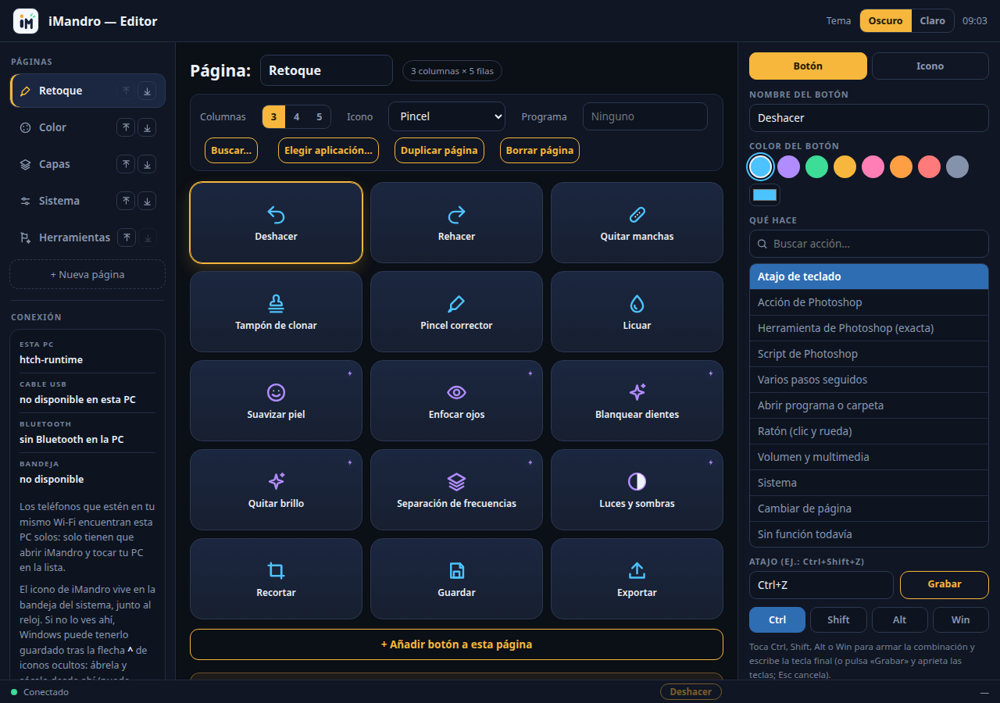
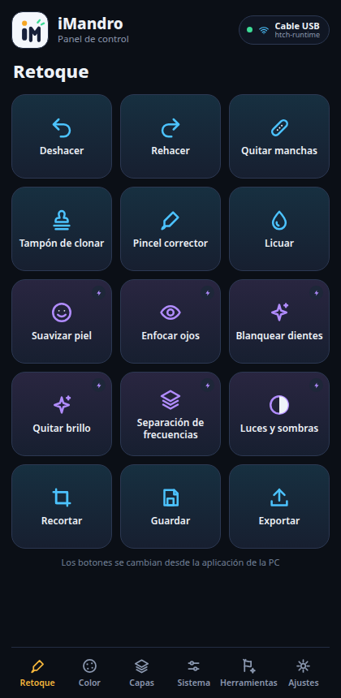

# iMandro

**Tu teléfono o tableta Android convertido en un panel de control para tu PC con Windows** — como un Stream Deck, pensado ante todo para trabajar en **Adobe Photoshop**: herramientas exactas, acciones, scripts, atajos de teclado, clics de ratón y apertura de programas, todo a un toque y por tu red local, **sin internet y sin cuentas**.

## Cómo funciona

- **En la PC** corre el programa de iMandro (Windows): guarda la configuración, atiende a los teléfonos y ejecuta lo que tocas. Se abre en **su propia ventana** y sigue trabajando en la bandeja del sistema aunque la cierres.
- **En el teléfono o la tableta** va el panel: una parrilla de botones grandes que tú diseñas desde el editor de la PC — páginas, columnas, colores, iconos y funciones a tu gusto.
- Cada teléfono se **empareja con un código de 6 dígitos** y tu permiso: ningún otro equipo de la misma Wi-Fi puede controlar tu PC.
- Conexión por **Wi-Fi local**; en Android también por **Bluetooth** y por **cable USB de emergencia**.
- La configuración vive en la PC: cualquier teléfono conectado a esa PC muestra el mismo panel. Cada equipo solo guarda sus ajustes propios (tema, posición de la barra de páginas, estilo, tamaño y vista de botones).

## Qué puede hacer cada botón

- Atajos de teclado (con Ctrl, Shift, Alt y Win combinados, también durante un clic de ratón).
- Las **70 herramientas de Photoshop** por su nombre interno exacto, **acciones** y **scripts JSX**.
- Clics de ratón (izquierdo, derecho, central, doble y rueda).
- Abrir programas o carpetas — con el botón **«Elegir aplicación…»**, que enseña la lista de aplicaciones instaladas en la PC.
- Volumen y teclas multimedia, comandos del sistema y cambio de página.
- Secuencias de varios pasos seguidos.

## Instalación

1. En la PC con Windows, instala **Instalar-iMandro-v1.9.2.exe** (está en la Release de esta versión).
2. En el teléfono o la tableta Android, instala **iMandro-Android-v1.9.2.apk**.
3. Abre iMandro en los dos equipos estando en la misma Wi-Fi, y empareja el teléfono con el código de 6 dígitos que enseña la PC.

## El código

- `pc/` — el programa de Windows: `servidor.py` (Python 3, solo biblioteca estándar), `aplicacion.py` (la ventana propia, con WebView2), `bandeja.py` (el icono de la bandeja) y `static/` (el editor y el panel).
- `android/` — la aplicación Android (Java, una cáscara WebView que carga el mismo panel de `pc/static/`), con su receta de compilación en `COMPILACION.md`.
- `generadores-iconos/` — el generador de los paquetes de iconos integrados.
- `Scripts-herramientas-Photoshop.txt` — los guiones JSX de referencia de las 70 herramientas.

La llave de firma de Android **no** se publica (nunca debe publicarse): quien compile la APK debe generar la suya.

## Nota sobre los iconos de Windows

Esta publicación **no incluye el paquete de iconos con los logos reales de aplicaciones de Windows** (Chrome, Office, Adobe y demás): esos logos son marcas registradas de sus empresas y no son nuestros para redistribuir. El programa funciona igual con los paquetes de Photoshop y con «Mis iconos», donde cada quien puede añadir los suyos.

## Colabora

**Se busca colaborador para hacer el cliente de iPhone.** El panel ya es una página web y el cliente de Android sirve de referencia: faltaría la cáscara en Swift para iOS (conexión solo por Wi-Fi). El llamamiento completo, en español y en inglés, está en [docs/llamamiento-cliente-iphone.md](docs/llamamiento-cliente-iphone.md).

## Licencia

iMandro es software libre: puedes usarlo, estudiarlo, modificarlo y compartirlo bajo los términos de la **GNU General Public License v3.0** (archivo `LICENSE`).

**Copyright © 2026 Liesky Vázquez.**

El nombre **iMandro** y su logo son de su autor y no forman parte de la licencia del código.
